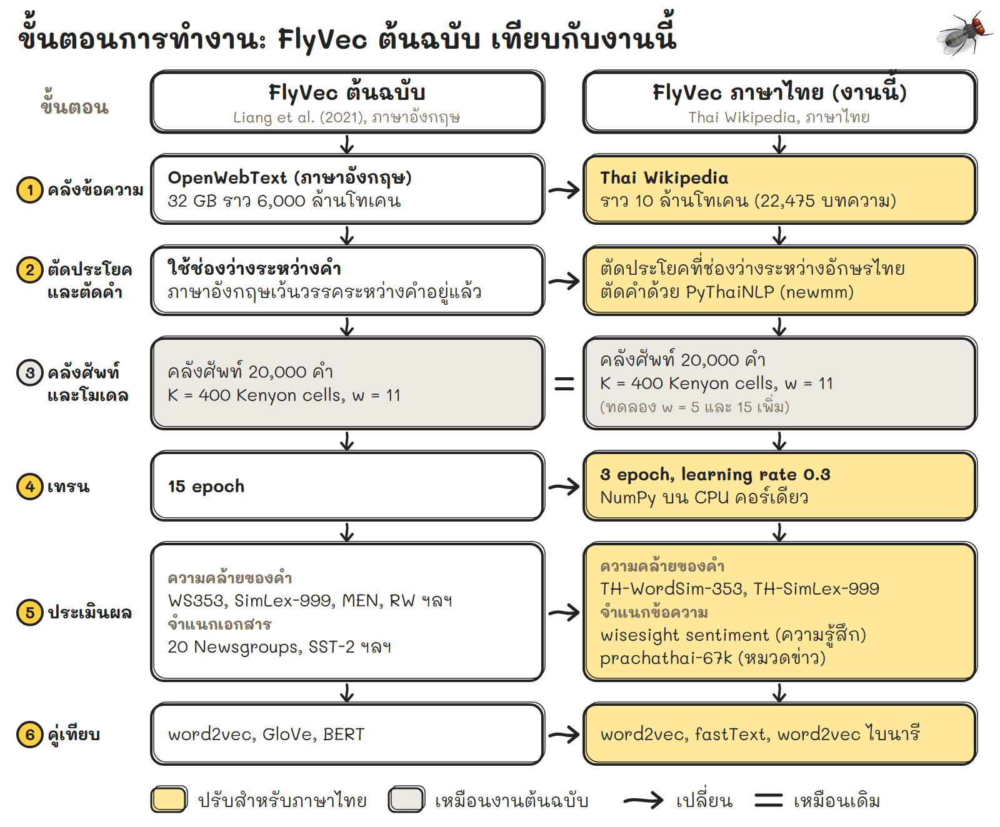

# แมลงวันอ่านภาษาไทยได้ไหม? word embedding แบบไบนารีสำหรับภาษาไทยด้วยแนวคิดจากสมองแมลงวัน

**Can a Fruit Fly Read Thai? Sparse Binary Word Embeddings for Thai Inspired by the Fruit Fly Brain**

สมาชิก: สหรัฐ อุดมวัฒน์ทวี รหัสนักศึกษา 6709650680 (ทำคนเดียว) 
รายวิชา CS374 การประมวลภาษาธรรมชาติ ภาคการศึกษาที่ 1/2569 
โค้ด: <a href="https://github.com/duckxy166/thai-flyvec">github.com/duckxy166/thai-flyvec</a>, รายงานฉบับเต็ม: <code>docs/report.md</code>

## 1 Introduction

**Pain point** word embedding ที่ใช้กันทั่วไป เช่น word2vec และ fastText เก็บแต่ละคำเป็นเวกเตอร์ทศนิยม 300 มิติ หรือราว 1,200 ไบต์ต่อคำ คลังศัพท์ 20,000 คำจึงใช้พื้นที่ 23.6 MB (word2vec) ถึง 252.5 MB (fastText) และการวัดความคล้ายต้องคำนวณด้วยทศนิยม ซึ่งหนักสำหรับอุปกรณ์ที่มีหน่วยความจำน้อย FlyVec (Liang et al., 2021) เลียนแบบวงจรรับกลิ่นของแมลงวันผลไม้ แทนแต่ละคำด้วยรหัสไบนารี 400 บิต (50 ไบต์) ที่มีบิตเป็น 1 เพียง k บิต เทียบกันได้ด้วยการนับบิตที่ซ้อนกัน และเรียนรู้โดยไม่ใช้ backpropagation แต่งานต้นฉบับทดลองกับภาษาอังกฤษเท่านั้น ภาษาไทยไม่มีช่องว่างระหว่างคำและไม่มีเครื่องหมายจบประโยค คุณภาพของ embedding จึงขึ้นกับการตัดคำและตัดประโยคด้วย และยังไม่มีใครทดสอบ FlyVec กับภาษาไทย

**วัตถุประสงค์**

1. นำ FlyVec มาเทรนกับคลังข้อความภาษาไทยเป็นครั้งแรก โดย implement ใหม่ด้วย NumPy
2. เปรียบเทียบกับ word2vec, fastText และ word2vec ที่แปลงเป็นไบนารี บนคลังข้อความ คลังศัพท์ และชุดทดสอบเดียวกัน
3. หาว่า FlyVec เหมาะกับข้อมูลและงานแบบไหน (คำถามจากการรีวิวการนำเสนอ)

**คำถามวิจัย** RQ1 ความคล้ายคลึงของคำใกล้ word2vec และ fastText เพียงใด, RQ2 ความแม่นยำในงานจำแนกข้อความลดลงเท่าใดเมื่อเทียบกับหน่วยความจำที่ประหยัดได้, RQ3 ความยาว hash k ค่าใดเหมาะกับภาษาไทย, RQ4 FlyVec เก่งและอ่อนกับคำหายาก ข้อความที่มีคำนอกคลังศัพท์มาก และงานจัดหมวดหัวข้ออย่างไร

## 2 Method

### 2.1 Workflow: งานเดิมเทียบกับงานของเรา

<figure markdown="1">

<figcaption>รูปที่ 1 ขั้นตอนของ FlyVec ต้นฉบับ (ซ้าย) เทียบกับงานนี้ (ขวา) กล่องสีเหลืองคือขั้นที่ปรับสำหรับภาษาไทย</figcaption>
</figure>

ไม่ใช้ OpenWebText ที่แปลเป็นไทยเพราะภาษาแปลมีความถี่คำและการเกิดร่วมของคำผิดธรรมชาติ และชุดทดสอบความคล้ายของคำก็แปลจากภาษาอังกฤษอยู่แล้ว จะเกิดอคติการแปลซ้ำซ้อน

### 2.2 ข้อมูลและการเตรียมข้อความ

ลบ markup ของวิกิ แปลงเลขไทยเป็นเลขอารบิก ตัดประโยคที่การขึ้นบรรทัดใหม่และที่ช่องว่างซึ่งมีอักษรไทยทั้งสองข้าง (ไม่ตัดกลาง "พ.ศ. 2563") ตัดคำด้วย newmm ทิ้งโทเคนที่ไม่มีตัวอักษรหรือตัวเลข แล้วสร้างคลังศัพท์ 20,000 คำที่พบบ่อยที่สุด ทุกโมเดลใช้คลังศัพท์ชุดนี้ร่วมกัน

| ชุดข้อมูล | ใช้ทำอะไร | ขนาด |
|---|---|---|
| Thai Wikipedia (`20231101.th`) | เทรนทุกโมเดล | 10,000,129 โทเคน, 1,665,497 ประโยค |
| TH-SimLex-999, TH-WordSim-353 | ความคล้ายของคำ (Spearman ρ) | 743 / 212 คู่ที่ทุกโมเดลรู้จัก |
| wisesight_sentiment | จำแนกความรู้สึก 4 คลาส | 21,628 / 2,404 / 2,671 ข้อความ |
| prachathai-67k | จัดหมวดข่าว 12 หมวด (หลายหมวดต่อข่าว) | 54,379 / 6,721 / 6,789 ข่าว |

### 2.3 FlyVec

หน้าต่างขนาด w คำแทนด้วยเวกเตอร์ 0/1 ขนาด 2 × 20,000 มิติ ครึ่งแรกเป็นคำบริบท ครึ่งหลังเป็นคำเป้าหมาย ส่งเข้า Kenyon cell 400 เซลล์ แล้วให้เซลล์ที่ถูกกระตุ้นสูงสุดเป็นผู้ชนะ (winner-take-all) กฎการเรียนรู้ของ Krotov & Hopfield (2019) ปรับเฉพาะน้ำหนักของผู้ชนะไปทาง input ที่ถ่วงด้วย 1/ความถี่ของคำ เพื่อให้คำที่พบน้อยมีน้ำหนักมากกว่าคำพื้นฐาน ไม่ใช้ backpropagation รหัสของคำได้จากการป้อนเฉพาะคำเป้าหมายแล้วให้ k เซลล์ที่ตอบสนองสูงสุดเป็น 1 ค่า k ใช้ตอนสร้างรหัสเท่านั้น จึงเทรนครั้งเดียวแล้วทดลองได้หลาย k

### 2.4 Baseline และการประเมิน

- word2vec และ fastText (gensim) 300 มิติ skip-gram ขนาดหน้าต่างและจำนวน epoch เท่ากับ FlyVec
- word2vec ไบนารี: นำเวกเตอร์ word2vec มาให้ k ค่าสูงสุดเป็น 1 เพื่อแยกผลของ "การเป็นไบนารี" ออกจากผลของ "กฎการเรียนรู้แบบแมลงวัน"
- ความคล้ายของคำใช้ cosine กับทุกโมเดล คิด ρ บนคู่คำที่ทุกโมเดลรู้จัก
- งานจำแนกข้อความใช้ค่าเฉลี่ยของเวกเตอร์คำ + logistic regression เลือกค่า C บน validation แล้ววัดบน test ครั้งเดียว ข่าวที่มีหลายหมวดใช้ one-vs-rest
- ทดลอง w ∈ {5, 11, 15}, k ∈ {4, 8, 16, 32, 64} และ seed 0, 1, 2 รายงานค่าเฉลี่ย ± SD ของ 3 seed ตารางหลักใช้ w = 11
- RQ4 ใช้โมเดลชุดเดิมโดยไม่เทรนใหม่: แบ่งคู่คำเป็น 3 กลุ่มเท่าๆ กันตามความถี่ของคำที่พบน้อยกว่าในคู่ (คำหายาก), แบ่งข้อความ wisesight test ตามสัดส่วนโทเคนนอกคลังศัพท์ และเพิ่มงานจัดหมวดข่าว prachathai-67k

## 3 Results

### 3.1 ความคล้ายของคำและความยาว hash (RQ1, RQ3)

**ตารางที่ 1** ผลที่ w = 11 (ค่าเฉลี่ย ± SD ของ 3 seed)

| โมเดล | ρ TH-SimLex-999 | ρ TH-WordSim-353 | macro-F1 wisesight | ขนาดตอนใช้งาน |
|---|---:|---:|---:|---:|
| FlyVec k = 8 | **0.392 ± 0.032** | 0.430 ± 0.014 | 0.414 ± 0.006 | 0.95 MB |
| FlyVec k = 16 | 0.374 ± 0.013 | 0.427 ± 0.048 | 0.428 ± 0.011 | 0.95 MB |
| FlyVec k = 32 | 0.361 ± 0.022 | **0.439 ± 0.017** | 0.422 ± 0.006 | 0.95 MB |
| word2vec ไบนารี k = 8 | 0.352 ± 0.015 | 0.287 ± 0.033 | 0.410 ± 0.009 | 0.72 MB |
| word2vec ไบนารี k = 16 | 0.427 ± 0.015 | 0.362 ± 0.010 | 0.423 ± 0.016 | 0.72 MB |
| word2vec ไบนารี k = 32 | 0.455 ± 0.030 | 0.496 ± 0.010 | 0.412 ± 0.018 | 0.72 MB |
| word2vec 300 มิติ | 0.513 ± 0.002 | 0.590 ± 0.005 | 0.425 ± 0.003 | 23.6 MB |
| fastText 300 มิติ | 0.548 ± 0.001 | 0.652 ± 0.005 | 0.424 ± 0.003 | 252.5 MB |

- FlyVec ได้ ρ ราว 74-76% ของ word2vec (ดีที่สุด SimLex 0.392 ที่ k = 8, WordSim 0.439 ที่ k = 32) และสูงสุดราว 84-86% ที่ w = 5
- เมื่อรหัสสั้น (k ≤ 8) FlyVec ชนะ word2vec ไบนารีทั้งสองชุด แต่ตั้งแต่ k ≥ 16 word2vec ไบนารีดีกว่าและดีขึ้นตาม k ขณะที่ FlyVec สูงสุดที่ k = 8-32
- k = 16-32 ให้ผลรวมดีที่สุด (RQ3) ขนาดรหัส 400 บิตไม่เปลี่ยนตาม k

### 3.2 ความแม่นยำเทียบกับทรัพยากร (RQ2)

ใน wisesight ทุกโมเดลที่ k ≥ 16 ได้ macro-F1 0.41-0.43 ต่างกันภายใน SD ขณะที่รหัสของ FlyVec ทั้งคลังศัพท์ใช้ 0.95 MB เล็กกว่าไฟล์ word2vec 24.8 เท่า และเล็กกว่า fastText ราว 265 เท่า เวลาเทรนของ implementation นี้ 2.7 / 6.8 / 9.6 นาทีที่ w = 5 / 11 / 15 ยังนานกว่า word2vec 1.7-4.6 เท่า เพราะใช้ NumPy คอร์เดียวเทียบกับ gensim ที่เขียนด้วย C และใช้ 4 thread

### 3.3 FlyVec เก่งอะไร (RQ4)

ใช้โมเดลชุดเดิม 3 seed ที่ w = 11 (ตัวเลข baseline อาจต่างจากตารางที่ 1 ไม่เกินราว 0.01 เพราะ gensim ใช้หลาย thread)

**ตารางที่ 2** ρ บน TH-SimLex-999 แยกตามความถี่ของคำที่พบน้อยกว่าในคู่ (กลุ่มละราว 248 คู่) และ macro-F1 ของงานจัดหมวดข่าว prachathai-67k

| โมเดล | ρ คำหายาก | ρ คำกลาง | ρ คำพบบ่อย | macro-F1 หมวดข่าว | micro-F1 หมวดข่าว |
|---|---:|---:|---:|---:|---:|
| FlyVec k = 16 | 0.298 ± 0.015 | 0.277 ± 0.014 | 0.573 ± 0.036 | 0.482 ± 0.004 | 0.597 ± 0.004 |
| FlyVec k = 32 | 0.281 ± 0.072 | 0.307 ± 0.031 | 0.504 ± 0.021 | **0.484 ± 0.004** | **0.597 ± 0.002** |
| word2vec ไบนารี k = 16 | 0.391 ± 0.012 | 0.419 ± 0.049 | 0.478 ± 0.036 | 0.469 ± 0.005 | 0.587 ± 0.002 |
| word2vec ไบนารี k = 32 | 0.408 ± 0.014 | 0.469 ± 0.015 | 0.542 ± 0.040 | 0.475 ± 0.004 | 0.590 ± 0.002 |
| word2vec 300 มิติ | 0.425 ± 0.003 | 0.555 ± 0.003 | 0.623 ± 0.004 | 0.480 ± 0.000 | 0.594 ± 0.001 |
| fastText 300 มิติ | **0.481 ± 0.002** | **0.574 ± 0.005** | **0.631 ± 0.002** | 0.483 ± 0.002 | 0.596 ± 0.001 |

- **จัดหมวดข่าว (เก่ง)** FlyVec k = 32 ได้ macro-F1 เท่ากับ fastText และสูงกว่า word2vec เล็กน้อย ทั้งที่ใช้พื้นที่เล็กกว่า 25-265 เท่า และชนะ word2vec ไบนารีที่ k เท่ากันทุกค่า (k = 8 ต่างกัน 0.023)
- **คำหายาก (อ่อน)** ในกลุ่มคำพบบ่อย FlyVec ได้ราว 92% ของ word2vec แต่ในกลุ่มคำหายากและคำกลางได้เพียง 50-70% ส่วน fastText ได้เปรียบที่สุดในกลุ่มคำหายากเพราะมี subword บน TH-WordSim-353 แต่ละกลุ่มมีเพียง 70 คู่ SD สูงจนสรุปไม่ได้
- **ข้อความที่มีคำนอกคลังศัพท์มาก** เมื่อแบ่ง wisesight test ตามสัดส่วนโทเคนนอกคลังศัพท์ (0%, 0-10%, 10-20%, >20%) FlyVec ไม่ได้อ่อนลงเป็นพิเศษ subword ของ fastText ช่วยในกลุ่ม 0-20% (macro-F1 0.389-0.397 เทียบ 0.360-0.377) แต่แย่ลงในกลุ่ม >20% (0.438 เทียบ 0.484) ซึ่งเป็นภาษาพูด คำสะแลง หรือคำสะกดผิด

## 4 Conclusion and Discussion

**คำตอบของคำถามวิจัย**

1. **RQ1** FlyVec เรียนรู้ความหมายจากภาษาไทยได้โดยไม่ใช้ backpropagation ได้ ρ ราว 74-76% ของ word2vec ที่ w = 11 และชนะ word2vec ไบนารีเมื่อรหัสสั้น (k ≤ 8)
2. **RQ2** ในงานจำแนกข้อความ ความแม่นยำแทบไม่ลดลง (wisesight ต่างจาก word2vec ไม่เกิน 0.006, prachathai เท่ากับ fastText) ขณะที่หน่วยความจำลดลง 24.8 เท่า
3. **RQ3** k = 16-32 เหมาะที่สุดโดยรวม
4. **RQ4** FlyVec เก่งงานที่แยกตาม**หัวข้อ** และอ่อนกับ**คำหายาก** จึงเหมาะกับข้อความภาษาเขียนที่หัวข้อชัด เช่น ข่าวหรือสารานุกรม มากกว่างานที่ต้องการความหมายละเอียดของคำเดี่ยวหรือคำที่พบน้อย

**อภิปราย** ผลนี้สอดคล้องกับงานต้นฉบับที่ FlyVec ได้ผลใกล้ BERT บน 20 Newsgroups แต่อ่อนบน SimLex และ Rare Words คำอธิบายที่เป็นไปได้มาจากโครงสร้างของมัน (1) winner-take-all ให้ Kenyon cell แต่ละเซลล์ถนัดหัวข้อเฉพาะ เช่น เคมี ของมีคม วันที่ รหัสของคำจึงบอกว่าคำอยู่ในหัวข้อไหนได้ดี เมื่อเฉลี่ยทั้งข่าวจึงแยกหมวดได้ดี (2) กฎการเรียนรู้ปรับเฉพาะเซลล์ผู้ชนะ คำที่พบน้อยจึงถูกเรียนรู้น้อยครั้ง รหัสยังไม่นิ่ง ต่างจาก word2vec ที่ทุกคำได้ gradient ทุกครั้งที่ปรากฏ และไม่มี subword แบบ fastText (3) งาน sentiment ขึ้นกับคำปฏิเสธและลำดับคำซึ่งค่าเฉลี่ยเวกเตอร์คำไม่เก็บ ทุกโมเดลจึงได้ผลใกล้กัน

**ข้อจำกัด** learning rate เลือกด้วย ρ บนชุดทดสอบเดียวกับที่รายงาน (ไม่มีชุด validation สำหรับความคล้ายของคำ), ใช้คลังข้อความเดียว 10 ล้านโทเคน, มี 3 seed และไม่ได้ทดสอบนัยสำคัญทางสถิติ, ชุดทดสอบความคล้ายของคำแปลมาจากภาษาอังกฤษและมีคู่คำนอกคลังศัพท์ 26-40%, และเวลาเทรนเทียบกับ gensim โดยตรงไม่ได้เพราะ implementation นี้ใช้ NumPy คอร์เดียว

**งานต่อไป** เพิ่มขนาดคลังข้อความเพื่อดูว่าช่องว่างของคำหายากแคบลงหรือไม่, เพิ่ม character n-gram เข้าไปใน input ของ FlyVec ให้คำนอกคลังศัพท์มีรหัส, วัดความเร็วค้นหาคำใกล้เคียงด้วย popcount ของรหัสสั้น, ทดลองงานจัดหมวดอื่น เช่น หัวข้อกระทู้หรือรีวิวสินค้า และเร่งการเทรนด้วยหลายคอร์หรือ GPU

## เอกสารอ้างอิง

1. Liang, Y., Ryali, C. K., Hoover, B., Grinberg, L., Navlakha, S., Zaki, M. J., & Krotov, D. (2021). Can a Fruit Fly Learn Word Embeddings? *ICLR*
2. Dasgupta, S., Stevens, C. F., & Navlakha, S. (2017). A neural algorithm for a fundamental computing problem. *Science, 358*(6364), 793-796
3. Krotov, D., & Hopfield, J. J. (2019). Unsupervised learning by competing hidden units. *PNAS, 116*(16), 7723-7731
4. Netisopakul, P., Wohlgenannt, G., & Pulich, A. (2019). Word Similarity Datasets for Thai: Construction and Evaluation. *IEEE Access, 7*
5. Suriyawongkul, A., Chuangsuwanich, E., Chormai, P., & Polpanumas, C. (2019). wisesight-sentiment, และ PyThaiNLP prachathai-67k, Hugging Face Datasets
6. Mikolov, T. et al. (2013). Distributed Representations of Words and Phrases and their Compositionality. *NeurIPS*; Bojanowski, P. et al. (2017). Enriching Word Vectors with Subword Information. *TACL, 5*
