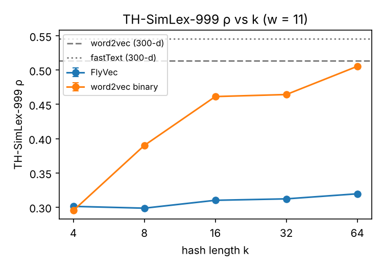
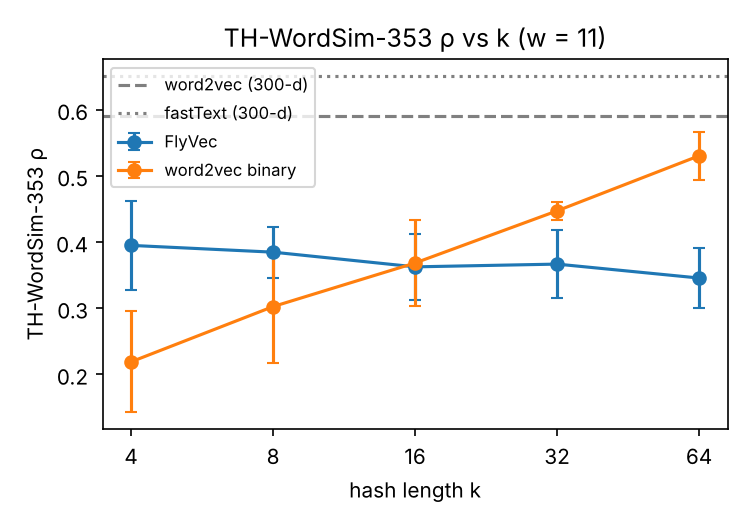
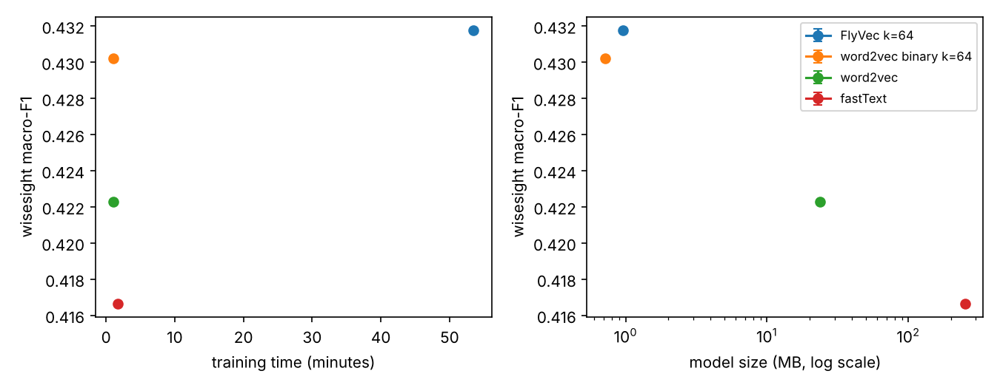
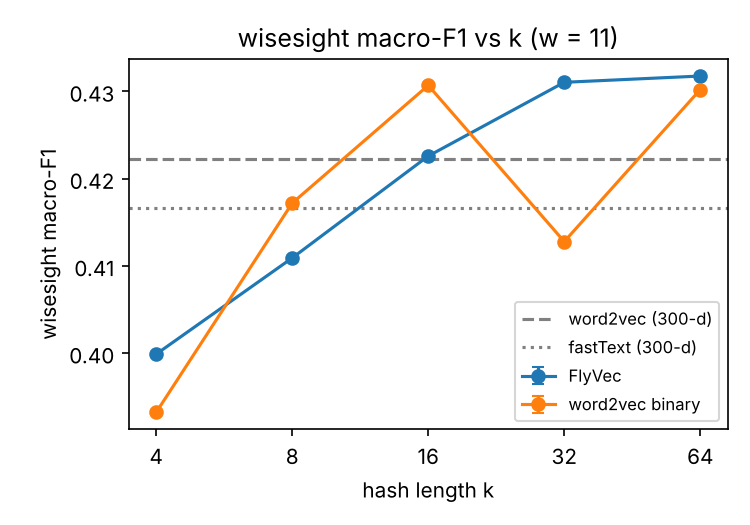

# แมลงวันอ่านภาษาไทยได้ไหม? การสร้าง word embedding แบบไบนารีสำหรับภาษาไทยด้วยแนวคิดจากสมองแมลงวัน

**Can a Fruit Fly Read Thai? Sparse Binary Word Embeddings for Thai Inspired by the Fruit Fly Brain**

สหรัฐ อุดมวัฒน์ทวี · รายวิชา คพ.374 การประมวลภาษาธรรมชาติ (CS374) ภาคการศึกษาที่ 1/2569

## บทคัดย่อ

โครงงานนี้นำ FlyVec ซึ่งเป็นวิธีสร้าง word embedding แบบไบนารีที่เลียนแบบวงจรรับกลิ่นของแมลงวันผลไม้ มาเทรนกับ Thai Wikipedia ขนาด 10 ล้านโทเคน แล้วเปรียบเทียบกับ word2vec, fastText และ word2vec ที่แปลงเป็นไบนารี บนคลังศัพท์ 20,000 คำชุดเดียวกัน ทดลองขนาดหน้าต่าง 3 ค่า × 3 seed และความยาว hash 5 ค่า ผลที่หน้าต่าง 11 คำพบว่า FlyVec ได้ Spearman ρ บน TH-SimLex-999 สูงสุด 0.350 ± 0.027 เทียบกับ 0.513 ± 0.001 ของ word2vec และต่ำกว่า word2vec แบบไบนารีที่ k ≥ 8 ในการจำแนกความรู้สึกบน wisesight FlyVec ได้ macro-F1 0.422 ± 0.011 ใกล้เคียง word2vec (0.426 ± 0.007) ภายในส่วนเบี่ยงเบนมาตรฐาน ขณะที่รหัสของทั้งคลังศัพท์ใช้พื้นที่ 0.95 MB หรือเล็กกว่าไฟล์ word2vec 24.8 เท่า อย่างไรก็ตาม การ implement ด้วย NumPy บน CPU คอร์เดียวใช้เวลาเทรน 52–58 นาที นานกว่า word2vec ของ gensim หลายสิบเท่า ผลนี้ได้จาก learning rate ที่ยังไม่ได้ปรับบนคลังข้อความจริง

## 1 บทนำ

word embedding แบบดั้งเดิม เช่น word2vec และ fastText แทนแต่ละคำด้วยเวกเตอร์ทศนิยมหลายร้อยมิติ ทำให้คลังศัพท์ขนาดกลางใช้หน่วยความจำหลายสิบเมกะไบต์ และการวัดความคล้ายต้องคำนวณด้วยจำนวนทศนิยม Liang et al. (2021) เสนอ FlyVec ซึ่งเลียนแบบวงจรรับกลิ่นของแมลงวันผลไม้ แทนแต่ละคำด้วยรหัสไบนารีที่มีบิตเป็น 1 เพียงไม่กี่บิต รหัสลักษณะนี้เก็บได้ในพื้นที่น้อยและเปรียบเทียบได้ด้วยการนับบิตที่ซ้อนกัน งานต้นฉบับทดลองกับภาษาอังกฤษเท่านั้น

ภาษาไทยมีลักษณะที่ต่างจากภาษาอังกฤษในขั้นเตรียมข้อมูล ได้แก่ ไม่มีช่องว่างระหว่างคำ ไม่มีเครื่องหมายจบประโยค และใช้ช่องว่างแทนการขึ้นประโยคหรืออนุประโยคใหม่ คุณภาพของ embedding จึงขึ้นกับการตัดคำและการตัดประโยคด้วย โครงงานนี้นำ FlyVec มาเทรนกับภาษาไทยเป็นครั้งแรก และเปรียบเทียบกับ word2vec, fastText และ word2vec ที่แปลงเป็นไบนารี บนคลังข้อความ คลังศัพท์ และชุดทดสอบเดียวกัน เพื่อตอบคำถามวิจัย 3 ข้อ

1. **RQ1** FlyVec ที่เทรนจากคลังข้อความภาษาไทยได้คะแนนความคล้ายคลึงของคำใกล้เคียง word2vec และ fastText เพียงใด
2. **RQ2** เมื่อนำไปจำแนกความรู้สึกของข้อความภาษาไทย ความแม่นยำลดลงเท่าใด เมื่อเทียบกับหน่วยความจำและเวลาเทรนที่ประหยัดได้
3. **RQ3** ความยาว hash (k) ค่าใดเหมาะสมกับภาษาไทย

## 2 งานที่เกี่ยวข้อง

**ระบบรับกลิ่นของแมลงวันกับการ hash** Dasgupta et al. (2017) อธิบายว่าวงจรรับกลิ่นของแมลงวันผลไม้ทำงานคล้ายการ hash แบบ locality-sensitive คือส่งสัญญาณจาก projection neuron จำนวนน้อยไปยัง Kenyon cell จำนวนมาก แล้วใช้การยับยั้งแบบ winner-take-all ให้เหลือเพียงเซลล์ที่ถูกกระตุ้นสูงสุดไม่กี่เซลล์ ผลคือกลิ่นที่คล้ายกันได้รหัสที่คล้ายกัน

**FlyVec** Liang et al. (2021) นำโครงสร้างนี้มาใช้กับข้อความ input ของแต่ละหน้าต่างประกอบด้วยคำบริบทและคำเป้าหมาย น้ำหนักจาก input ไปยัง Kenyon cell เรียนรู้ด้วยกฎแบบ biologically plausible ของ Krotov & Hopfield (2019) ซึ่งปรับเฉพาะเซลล์ที่ชนะ โดยไม่ใช้ backpropagation งานต้นฉบับรายงานว่า FlyVec ได้ผลใกล้เคียงวิธีเดิมในงาน NLP หลายงาน โดยใช้ทรัพยากรการคำนวณเพียงส่วนน้อย ทั้งเวลาเทรนที่สั้นกว่าและหน่วยความจำที่น้อยกว่า

**ชุดทดสอบภาษาไทย** Netisopakul et al. (2019) แปลและให้คะแนนใหม่สำหรับ WordSim-353 และ SimLex-999 ภาษาไทย ส่วนชุดข้อมูล wisesight_sentiment (Suriyawongkul et al., 2019) เป็นข้อความโซเชียลมีเดียภาษาไทยที่มีป้ายความรู้สึก 4 คลาส

## 3 ข้อมูล

### 3.1 คลังข้อความสำหรับเทรน

ใช้ Thai Wikipedia จากชุดข้อมูล `wikimedia/wikipedia` (config `20231101.th`) สลับลำดับบทความด้วย seed 0 แล้วเลือกบทความตามลำดับจนได้ราว 10 ล้านโทเคนหลังตัดคำ ขนาดนี้เลือกเพื่อให้เทรนบน CPU ได้ (`docs/decisions.md` D1)

| รายการ | ค่า |
|---|---:|
| จำนวนบทความ | 22,475 |
| จำนวนโทเคน | 10,000,129 |
| จำนวนประโยค | 1,665,497 |
| ขนาดคลังศัพท์ | 20,000 คำ |
| สัดส่วนโทเคนนอกคลังศัพท์ | 5.7% |

### 3.2 ชุดทดสอบ

| ชุดข้อมูล | ใช้วัด | ขนาด |
|---|---|---|
| TH-WordSim-353 | ความเกี่ยวข้องของคำ (relatedness) | 353 คู่ |
| TH-SimLex-999 | ความคล้ายของคำ (similarity) | 999 คู่ |
| wisesight_sentiment | การจำแนกความรู้สึก 4 คลาส (บวก กลาง ลบ คำถาม) | train 21,628 / validation 2,404 / test 2,671 ข้อความ |

## 4 วิธีการ

### 4.1 การเตรียมข้อความ

1. ลบ markup ของวิกิด้วย regular expression (template, ตาราง, ลิงก์, `<ref>`, HTML tag) แปลงเลขไทยเป็นเลขอารบิก และลดอักษรไทยที่ซ้ำเกินสองตัว
2. ตัดประโยคที่การขึ้นบรรทัดใหม่ และที่ช่องว่างซึ่งมีอักษรไทยอยู่ทั้งสองข้าง วิธีนี้ไม่ตัดกลาง "พ.ศ. 2563" หรือวลีภาษาอังกฤษ
3. ตัดคำด้วย PyThaiNLP (engine `newmm`) ทิ้งโทเคนที่ไม่มีตัวอักษรหรือตัวเลข และแปลงอักษรละตินเป็นตัวเล็ก
4. สร้างคลังศัพท์จากคำที่พบบ่อยที่สุด 20,000 คำ ทุกโมเดลใช้คลังศัพท์ชุดนี้ร่วมกัน

### 4.2 รูปแบบ input ของ FlyVec

แต่ละหน้าต่างขนาด w คำ แทนด้วยเวกเตอร์ 0/1 ขนาด 2 × 20,000 = 40,000 มิติ ครึ่งแรกแทนคำบริบท ครึ่งหลังแทนคำเป้าหมาย หน้าต่างไม่ข้ามขอบประโยค และข้ามหน้าต่างที่คำเป้าหมายอยู่นอกคลังศัพท์ เนื่องจากเวกเตอร์มีค่า 1 ไม่เกิน w ตำแหน่ง การ implement จึงเก็บเฉพาะดัชนีคำของแต่ละหน้าต่าง ผลลัพธ์เท่ากับนิยามเดิมทุกประการ แต่ใช้หน่วยความจำน้อยลงราว 40,000 / w เท่า (D2)

### 4.3 กฎการเรียนรู้

ให้ $\mathbf{v}^A$ เป็น input ของหน้าต่าง $A$ และ $\mathbf{p}$ เป็นความน่าจะเป็นของคำ (ใช้ซ้ำกับทั้งสองครึ่งของ input) Kenyon cell $\mu$ มีเวกเตอร์น้ำหนัก $\mathbf{W}_\mu$ การเทรนลดค่า energy

$$E = -\sum_{A} \frac{\langle \mathbf{W}_{\hat\mu}, \mathbf{v}^A / \mathbf{p} \rangle}{\lVert \mathbf{W}_{\hat\mu} \rVert}, \qquad \hat\mu = \arg\max_\mu \langle \mathbf{W}_\mu, \mathbf{v}^A \rangle$$

โดยปรับเฉพาะเซลล์ผู้ชนะ $\hat\mu$ ตามกฎ

$$\Delta \mathbf{W}_{\hat\mu} = \frac{\mathbf{v}^A}{\mathbf{p}} - \left\langle \mathbf{W}_{\hat\mu}, \frac{\mathbf{v}^A}{\mathbf{p}} \right\rangle \mathbf{W}_{\hat\mu}$$

การถ่วงด้วย $1/\mathbf{p}$ ทำให้คำที่พบน้อยมีน้ำหนักมากกว่าคำพื้นฐาน ส่วนเทอมลบทำให้ความยาวของน้ำหนักลู่เข้า 1 การเลือกผู้ชนะใช้ activation ที่ไม่ถ่วงด้วย $1/\mathbf{p}$ เพราะการทดลองเบื้องต้นพบว่าถ้าถ่วง คำเป้าหมายที่พบน้อยจะครอบงำการเลือกผู้ชนะแทนบริบท (D2)

การ implement ใช้ NumPy ทั้งหมด ค่าตั้งต้นของน้ำหนักสุ่มจาก N(0, 1) แล้วปรับให้แต่ละเซลล์มีความยาว 1 เทรนเป็น mini-batch ละ 1,024 หน้าต่าง update ของแต่ละ batch หารด้วยค่าสัมบูรณ์สูงสุดของมันแล้วคูณ learning rate ที่ลดเชิงเส้นจาก 1.0 ถึง 0 ตามโค้ดของ Krotov & Hopfield (2019) ใช้ Kenyon cell K = 400 เซลล์ และเทรน 3 epoch (D10)

### 4.4 รหัส hash ของคำ

รหัสของคำได้จากการป้อนเฉพาะครึ่งคำเป้าหมาย แล้วกำหนดให้ k เซลล์ที่ถูกกระตุ้นสูงสุดเป็น 1 ที่เหลือเป็น 0 ค่า k ใช้เฉพาะตอนสร้างรหัส จึงทดลองหลายค่าได้โดยไม่ต้องเทรนใหม่ (D3)

### 4.5 Baseline

- **word2vec** และ **fastText** (gensim) 300 มิติ แบบ skip-gram, negative sampling 5, ขนาดหน้าต่างและจำนวน epoch เท่ากับ FlyVec ใช้คลังศัพท์ 20,000 คำชุดเดียวกัน fastText ใช้ n-gram bucket 200,000 (D6, D10)
- **word2vec แบบไบนารี** นำเวกเตอร์ word2vec มากำหนดให้ k ค่าสูงสุดเป็น 1 ที่เหลือเป็น 0 ด้วย k ชุดเดียวกับ FlyVec เพื่อแยกผลของ "การเป็นไบนารี" ออกจากผลของ "กฎการเรียนรู้แบบแมลงวัน" (D5)
- **fastText + subword** เป็นแถวเพิ่มเติมที่ใช้ subword สร้างเวกเตอร์ให้คำนอกคลังศัพท์ (D6)

### 4.6 ตัววัดความคล้าย

ใช้ cosine similarity กับทุกโมเดล สำหรับรหัสที่มีบิตเป็น 1 ครบ k บิต cosine เท่ากับ overlap / k ซึ่งเป็นฟังก์ชันทางเดียวของจำนวนบิตที่ซ้อนกัน เช่นเดียวกับ Jaccard และ Hamming ค่า Spearman ρ จึงเท่ากันไม่ว่าเลือกตัววัดใด (D4)

## 5 การออกแบบการทดลอง

- **ความคล้ายคลึงของคำ** คำนวณ Spearman ρ ระหว่าง cosine ของคู่คำกับคะแนนจากมนุษย์ คู่คำที่คำใดคำหนึ่งไม่อยู่ในคลังศัพท์นับเป็น OOV และไม่นำมาคิด ทุกโมเดลคำนวณบนคู่คำชุดเดียวกัน (D7)
- **การจำแนกความรู้สึก** เวกเตอร์ข้อความคือค่าเฉลี่ยของเวกเตอร์คำที่อยู่ในคลังศัพท์ (ข้อความที่ไม่มีคำในคลังศัพท์ใช้เวกเตอร์ศูนย์) จำแนกด้วย logistic regression หลัง standardize เลือกค่า C จาก {0.01, 0.1, 1, 10, 100} ด้วย macro-F1 บนชุด validation แล้วรายงาน accuracy และ macro-F1 บนชุด test (D8)
- **ทรัพยากร** วัดเวลาเทรน (รวมการสร้างหน้าต่างสำหรับ FlyVec) และขนาดไฟล์โมเดล และรายงานขนาดของรหัสไบนารีที่ใช้งานจริงแยกต่างหาก
- **ค่าที่ทดลอง** ขนาดหน้าต่าง w ∈ {5, 11, 15}, seed ∈ {0, 1, 2} และ k ∈ {4, 8, 16, 32, 64} รายงานค่าเฉลี่ย ± ส่วนเบี่ยงเบนมาตรฐานของ 3 seed (D9)
- **เครื่องที่ใช้** Intel Xeon 2.10 GHz 4 คอร์, หน่วยความจำ 15.7 GB, Python 3.13, NumPy 2.5.3, gensim 4.4.0 (`results/machine.json`) การตั้งค่า w = 11, seed 0 รันเดี่ยว ส่วนอีก 8 การตั้งค่ารันพร้อมกันครั้งละ 4 การตั้งค่า เวลาเทรนที่วัดได้จึงรวมผลของการแย่ง CPU กันด้วย

## 6 ผลการทดลอง

ตัวเลขทั้งหมดเป็นค่าเฉลี่ย ± ส่วนเบี่ยงเบนมาตรฐานของ 3 seed ตารางหลักใช้ w = 11 ตามค่าเริ่มต้นของงานต้นฉบับ ตารางครบทุกค่าอยู่ใน `results/summary.md` และ `notebooks/results.ipynb`

### 6.1 ความคล้ายคลึงของคำ (RQ1)

**ตารางที่ 1** Spearman ρ และ macro-F1 ที่ w = 11 (ρ คำนวณบนคู่คำที่ทุกโมเดลรู้จัก: TH-SimLex-999 743 คู่, TH-WordSim-353 212 คู่)

| โมเดล | k | ρ TH-SimLex-999 | ρ TH-WordSim-353 | accuracy wisesight | macro-F1 wisesight |
|---|---:|---:|---:|---:|---:|
| FlyVec | 4 | 0.289 ± 0.022 | 0.395 ± 0.068 | 0.600 ± 0.009 | 0.396 ± 0.004 |
| FlyVec | 8 | 0.329 ± 0.027 | 0.385 ± 0.039 | 0.616 ± 0.006 | 0.405 ± 0.007 |
| FlyVec | 16 | 0.331 ± 0.032 | 0.363 ± 0.050 | 0.619 ± 0.001 | 0.418 ± 0.006 |
| FlyVec | 32 | 0.347 ± 0.030 | 0.367 ± 0.051 | 0.620 ± 0.011 | 0.419 ± 0.013 |
| FlyVec | 64 | 0.350 ± 0.027 | 0.346 ± 0.045 | 0.619 ± 0.006 | 0.422 ± 0.011 |
| word2vec ไบนารี | 4 | 0.302 ± 0.020 | 0.219 ± 0.076 | 0.604 ± 0.008 | 0.397 ± 0.007 |
| word2vec ไบนารี | 8 | 0.370 ± 0.017 | 0.303 ± 0.086 | 0.609 ± 0.008 | 0.411 ± 0.009 |
| word2vec ไบนารี | 16 | 0.425 ± 0.034 | 0.369 ± 0.065 | 0.621 ± 0.009 | 0.418 ± 0.015 |
| word2vec ไบนารี | 32 | 0.454 ± 0.020 | 0.447 ± 0.013 | 0.617 ± 0.002 | 0.407 ± 0.011 |
| word2vec ไบนารี | 64 | 0.484 ± 0.025 | 0.531 ± 0.036 | 0.625 ± 0.005 | 0.425 ± 0.014 |
| word2vec (300 มิติ) | | 0.513 ± 0.001 | 0.590 ± 0.006 | 0.628 ± 0.004 | 0.426 ± 0.007 |
| fastText (300 มิติ) | | 0.546 ± 0.001 | 0.651 ± 0.005 | 0.623 ± 0.002 | 0.422 ± 0.005 |

 

ข้อค้นพบ

1. **FlyVec ได้ ρ ต่ำกว่า word2vec และ fastText แบบ 300 มิติทุกการตั้งค่า** ที่ w = 11 ค่าที่ดีที่สุดของ FlyVec บน SimLex คือ 0.350 หรือราว 68% ของ word2vec (0.513) และบน WordSim คือ 0.395 หรือราว 67% (0.590) เมื่อพิจารณาทุกขนาดหน้าต่าง FlyVec ทำได้ดีที่สุดบน SimLex ที่ w = 5, k = 64 (0.407 ± 0.037) คิดเป็นราว 86% ของ word2vec ที่ w เดียวกัน (0.471 ± 0.002)
2. **เมื่อเทียบกับ word2vec แบบไบนารีที่ k เท่ากัน** FlyVec ชนะเฉพาะที่ k เล็ก บน WordSim ที่ k = 4 FlyVec ได้ 0.395 เทียบกับ 0.219 แต่ตั้งแต่ k = 8 บน SimLex และ k = 16 บน WordSim ขึ้นไป word2vec แบบไบนารีได้ ρ สูงกว่า และเพิ่มขึ้นตาม k ขณะที่ FlyVec เกือบคงที่ ข้อดีของ FlyVec ในการทดลองนี้จึงเกิดเฉพาะเมื่อรหัสสั้นมาก
3. **ความแปรปรวนระหว่าง seed** ของ FlyVec บน WordSim สูง (SD 0.04–0.07) เพราะคำนวณจากคู่คำเพียง 212 คู่ ส่วนบน SimLex (743 คู่) SD อยู่ที่ราว 0.03 ในขณะที่ word2vec และ fastText มี SD ไม่เกิน 0.01
4. **คำนอกคลังศัพท์** คลังศัพท์ 20,000 คำครอบคลุมคู่คำได้เพียง 74.4% ของ SimLex และ 60.1% ของ WordSim เมื่อใช้ subword ของ fastText สร้างเวกเตอร์ให้คำนอกคลังศัพท์ ประเมินได้ครบทุกคู่ โดยได้ ρ 0.533 ± 0.002 (SimLex) และ 0.579 ± 0.005 (WordSim) ที่ w = 11 ซึ่งลดลงจากชุดคู่คำที่รู้จักเพียงเล็กน้อย

ตัวอย่างคำใกล้เคียงของ FlyVec (w = 11, seed 0, k = 16) แสดงว่ารหัสเก็บความหมายเชิงหัวข้อได้ เช่น "ฟุตบอล" ใกล้กับ แชมป์ เล่น ชนะ "ดนตรี" ใกล้กับ วงการ เพลง การแสดง และ "รถยนต์" ใกล้กับ suv โตโยต้า แต่ยังมีคำเชื่อม เช่น ซึ่ง จาก การ ปะปนอยู่ในรายการ

### 6.2 การจำแนกความรู้สึกเทียบกับทรัพยากร (RQ2)

**ตารางที่ 2** เวลาเทรนและขนาดโมเดล (เฉลี่ยทุก w และ seed)

| โมเดล | เวลาเทรน w = 5 / 11 / 15 (นาที) | ไฟล์โมเดล (MB) | ขนาดตอนใช้งาน (MB) |
|---|---|---:|---:|
| FlyVec | 52.4 / 56.5 / 58.4 | 61.0 | 0.95 (รหัส 400 บิต × 20,000 คำ) |
| word2vec | 1.1 / 2.4 / 3.9 | 23.6 | 23.6 (ไบนารี 0.72) |
| fastText | 2.4 / 4.4 / 7.3 | 252.5 | 252.5 |



ข้อค้นพบ

1. **ความแม่นยำลดลงน้อยมาก** ที่ w = 11 FlyVec ได้ macro-F1 0.422 ± 0.011 (k = 64) เทียบกับ word2vec 0.426 ± 0.007 และ fastText 0.422 ± 0.005 ลดลงเพียง 0.004 ซึ่งอยู่ภายในส่วนเบี่ยงเบนมาตรฐาน accuracy ลดลงจาก 0.628 เป็น 0.619 เมื่อ k ≥ 16 ทุกโมเดลอยู่ในช่วง macro-F1 0.41–0.43
2. **หน่วยความจำลดลงมาก** รหัสไบนารีของ FlyVec สำหรับทั้งคลังศัพท์ใช้ 0.95 MB เล็กกว่าไฟล์ word2vec 24.8 เท่า และเล็กกว่า fastText ราว 265 เท่า ส่วนน้ำหนักระหว่างเทรน (400 × 40,000 ค่า) มีขนาด 61 MB แต่ไม่จำเป็นต้องใช้หลังสร้างรหัสแล้ว
3. **เวลาเทรนไม่ได้ลดลงในการทดลองนี้** FlyVec ใช้เวลา 52–58 นาที นานกว่า word2vec 15–48 เท่า ข้อนี้ต่างจากงานต้นฉบับ สาเหตุหลักคือการ implement ด้วย NumPy ที่ทำงานบน CPU คอร์เดียว ขณะที่ gensim เขียนด้วย C และใช้ 4 thread การเปรียบเทียบเวลาเทรนจึงสะท้อนประสิทธิภาพของการ implement มากกว่าตัววิธี

### 6.3 ความยาว hash (RQ3)



- **SimLex** ρ ของ FlyVec เพิ่มตาม k ในทุกขนาดหน้าต่าง และสูงสุดที่ k = 64 (w = 5: 0.407, w = 11: 0.350, w = 15: 0.344)
- **WordSim** ค่า k ที่ดีที่สุดเปลี่ยนไปตาม w (k = 16, 4 และ 8 สำหรับ w = 5, 11 และ 15) และความต่างระหว่าง k น้อยกว่าส่วนเบี่ยงเบนมาตรฐาน จึงสรุปค่า k ที่ดีที่สุดจากชุดนี้ไม่ได้
- **การจำแนกความรู้สึก** macro-F1 เพิ่มจาก k = 4 ถึง k = 16 แล้วคงที่

ข้อเสนอแนะสำหรับภาษาไทยคือ **k = 32–64** ซึ่งให้ ρ บน SimLex และ macro-F1 สูงสุดหรือใกล้สูงสุด โดยขนาดรหัสแบบ bitmap 400 บิตไม่เปลี่ยนตาม k หากต้องการรหัสสั้นที่สุด k = 16 ยังให้ macro-F1 ใกล้เคียงค่าสูงสุด

### 6.4 ผลของขนาดหน้าต่าง

word2vec และ fastText ได้ ρ สูงขึ้นเมื่อหน้าต่างใหญ่ขึ้น (word2vec บน SimLex: 0.471, 0.513, 0.521 ที่ w = 5, 11, 15) แต่ FlyVec บน SimLex กลับได้ผลดีที่สุดที่หน้าต่างเล็ก (k = 64: 0.407, 0.350, 0.344) ส่วนบน WordSim ผลของ w ต่อ FlyVec อยู่ภายในส่วนเบี่ยงเบนมาตรฐาน macro-F1 ของทุกโมเดลแทบไม่เปลี่ยนตาม w

## 7 อภิปราย

**FlyVec เรียนรู้ความหมายจากภาษาไทยได้ แต่ยังด้อยกว่า embedding แบบดั้งเดิมในการวัดความคล้ายของคำ** คำใกล้เคียงที่ได้สอดคล้องกับหัวข้อของคำ และ ρ อยู่ราว 0.3–0.4 แต่ยังต่ำกว่า word2vec ชัดเจน และต่ำกว่า word2vec ที่แปลงเป็นไบนารีเมื่อรหัสยาวพอ หมายความว่าในการทดลองนี้ ข้อดีของ FlyVec ไม่ได้มาจากกฎการเรียนรู้แบบแมลงวันเอง แต่มาจากการใช้รหัสไบนารีแบบ sparse ซึ่งได้จาก word2vec เช่นกัน

**งานปลายทางแยกความต่างระหว่างโมเดลได้น้อย** ข้อความ wisesight เป็นภาษาพูดที่มีโทเคนนอกคลังศัพท์ 12.1% และมี 445 ข้อความที่ไม่มีคำในคลังศัพท์เลย การนำค่าเฉลี่ยของเวกเตอร์คำมาจำแนกด้วย logistic regression ก็เป็นวิธีที่หยาบ คุณภาพของ embedding จึงมีผลต่อผลลัพธ์น้อย ข้อสรุปว่า FlyVec "เสียความแม่นยำเพียงเล็กน้อย" จึงจำกัดอยู่ในเงื่อนไขนี้

**ปัจจัยที่อาจทำให้ FlyVec ได้ผลต่ำกว่าที่ควร** ได้แก่ (1) learning rate 1.0 เลือกจากการทดลองเบื้องต้นบนข้อความเพียงราว 0.5 ล้านโทเคน (D10) (2) คลังข้อความ 10 ล้านโทเคนเล็กกว่าที่งานต้นฉบับใช้มาก ขณะที่กฎแบบผู้ชนะได้ทั้งหมดปรับเพียงหนึ่งเซลล์ต่อหน้าต่าง จึงอาจต้องการข้อมูลมากกว่า (3) คำพื้นฐานที่พบบ่อยยังปรากฏในรายการคำใกล้เคียง ซึ่งบ่งว่าการถ่วงด้วยส่วนกลับของความถี่ยังไม่พอจะกำจัดผลของคำเหล่านี้ ข้อสันนิษฐานเหล่านี้ยังไม่ได้ทดสอบ

**ผลของหน้าต่างที่สวนทางกับ word2vec** FlyVec ได้ผลดีขึ้นบน SimLex เมื่อหน้าต่างเล็ก ข้อสันนิษฐานหนึ่งคือ เมื่อหน้าต่างใหญ่ บริบทจำนวนมากถูกรวมเป็น bag-of-words เดียวที่ใช้ตัดสินผู้ชนะ ข้อมูลที่บอกความคล้ายแบบใช้แทนกันได้ (similarity) ซึ่งมักอยู่ในคำข้างเคียงใกล้ๆ จึงถูกเจือจาง ข้อนี้ควรทดสอบเพิ่มเติม

## 8 ข้อจำกัด

1. **learning rate ยังไม่ได้ปรับบนคลังข้อความจริง** ตามแผนใน D10 ต้องลอง 0.3, 1 และ 3 ก่อนรันการทดลองหลัก ซึ่งยังไม่ได้ทำ
2. **เวลาเทรนเปรียบเทียบกันโดยตรงไม่ได้** FlyVec ใช้ NumPy คอร์เดียว ส่วน gensim ใช้ C และ 4 thread และ 8 ใน 9 การตั้งค่ารันพร้อมกัน 4 การตั้งค่า
3. **จำนวนบิตไม่เท่ากัน** FlyVec มี 400 บิต แต่ word2vec แบบไบนารีมี 300 บิต ความหนาแน่นที่ k เดียวกันจึงต่างกัน เช่น k = 64 คือ 16% กับ 21% (D5)
4. **ชุดทดสอบความคล้ายของคำ** แปลมาจากภาษาอังกฤษ และคู่คำ 26–40% อยู่นอกคลังศัพท์ WordSim เหลือเพียง 212 คู่ ทำให้ ρ แปรปรวนสูง
5. **จำนวน seed** มีเพียง 3 seed และไม่ได้ทดสอบนัยสำคัญทางสถิติ ความต่างที่อยู่ภายในส่วนเบี่ยงเบนมาตรฐานจึงไม่ควรตีความว่าแตกต่างจริง
6. **คลังข้อความเดียว** ใช้ Thai Wikipedia 10 ล้านโทเคนเพียงชุดเดียว ไม่ได้ทดสอบผลของขนาดคลังข้อความหรือโดเมนอื่น
7. **การจำแนกความรู้สึก** ใช้ค่าเฉลี่ยของเวกเตอร์คำกับ logistic regression ซึ่งไม่ไวต่อคุณภาพของ embedding

## 9 สรุปและงานต่อไป

FlyVec ใช้กับภาษาไทยได้ และเรียนรู้ความหมายเชิงหัวข้อของคำจาก Thai Wikipedia ได้โดยไม่ใช้ backpropagation คำตอบของคำถามวิจัยทั้ง 3 ข้อมีดังนี้

1. **RQ1** ที่ w = 11 ค่า ρ ที่ดีที่สุดของ FlyVec คิดเป็นราว 67% ของ word2vec บน WordSim (k = 4) และ 68% บน SimLex (k = 64) และสูงสุดราว 86% ที่ w = 5 บน SimLex (k = 64) แต่ยังต่ำกว่า word2vec แบบไบนารีเมื่อ k ≥ 8–16
2. **RQ2** ในการจำแนกความรู้สึก macro-F1 ลดลงเพียงราว 0.004 จาก word2vec ซึ่งอยู่ภายในส่วนเบี่ยงเบนมาตรฐาน ขณะที่หน่วยความจำลดลง 24.8 เท่า แต่เวลาเทรนของการ implement นี้นานกว่า word2vec หลายสิบเท่า
3. **RQ3** k = 32–64 ให้ผลดีที่สุดโดยรวม ส่วน k = 16 เป็นทางเลือกที่สั้นกว่าโดยเสียความแม่นยำในงานปลายทางน้อย

งานต่อไปที่ควรทำ ได้แก่ ปรับ learning rate ตาม D10, ขยายคลังข้อความเพื่อดูว่าช่องว่างกับ word2vec ลดลงหรือไม่, เขียนการเทรนให้ใช้หลายคอร์หรือ GPU เพื่อวัดเวลาเทรนอย่างเป็นธรรม, ทดลองลดผลของคำที่พบบ่อย และเพิ่มงานปลายทางที่ไวต่อคุณภาพของ embedding มากกว่าการจำแนกความรู้สึก

## เอกสารอ้างอิง

1. Liang, Y., Ryali, C. K., Hoover, B., Grinberg, L., Navlakha, S., Zaki, M. J., & Krotov, D. (2021). Can a Fruit Fly Learn Word Embeddings? *International Conference on Learning Representations (ICLR)*. https://arxiv.org/abs/2101.06887
2. Dasgupta, S., Stevens, C. F., & Navlakha, S. (2017). A neural algorithm for a fundamental computing problem. *Science, 358*(6364), 793–796.
3. Krotov, D., & Hopfield, J. J. (2019). Unsupervised learning by competing hidden units. *Proceedings of the National Academy of Sciences, 116*(16), 7723–7731.
4. Netisopakul, P., Wohlgenannt, G., & Pulich, A. (2019). Word Similarity Datasets for Thai: Construction and Evaluation. *IEEE Access, 7*.
5. Suriyawongkul, A., Chuangsuwanich, E., Chormai, P., & Polpanumas, C. (2019). PyThaiNLP/wisesight-sentiment. https://huggingface.co/datasets/pythainlp/wisesight_sentiment
6. Mikolov, T., Sutskever, I., Chen, K., Corrado, G., & Dean, J. (2013). Distributed Representations of Words and Phrases and their Compositionality. *Advances in Neural Information Processing Systems (NeurIPS)*.
7. Bojanowski, P., Grave, E., Joulin, A., & Mikolov, T. (2017). Enriching Word Vectors with Subword Information. *Transactions of the Association for Computational Linguistics, 5*, 135–146.

## ภาคผนวก: วิธีทำซ้ำผลการทดลอง

```bash
python scripts/download_data.py
python scripts/preprocess_corpus.py
python scripts/run_experiments.py          # w = 5, 11, 15 × seed 0, 1, 2
python scripts/summarize_results.py
```

ค่าที่ตั้งทั้งหมดและเหตุผลอยู่ใน `docs/decisions.md` ผลดิบอยู่ใน `results/raw_results.csv` และ `results/resources.csv`
